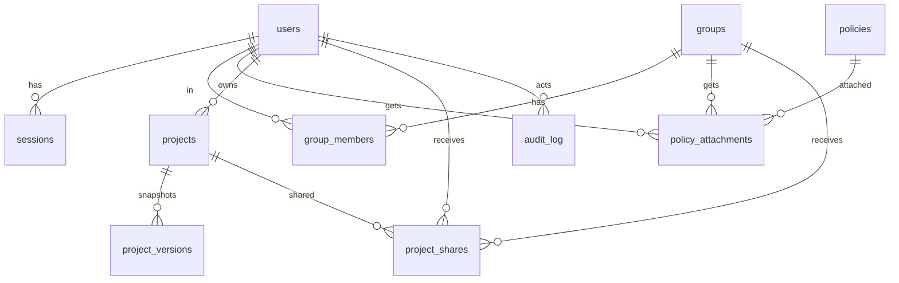

# Design decisions

Numbered `DD-nnn` to keep them apart from the specification's `D-nnn` ([../spec/decisions.md](../spec/decisions.md)). All are
**decided**: the owner accepted every recommendation (23 October 2026), including DD-010 (the platform produces files and never applies or holds credentials).

| ID | Status | Topic |
|---|---|---|
| DD-001 | decided | Language and runtime |
| DD-002 | decided | Repository layout |
| DD-003 | decided | How the engine reads the specification |
| DD-004 | decided | How rules are implemented |
| DD-005 | decided | How HCL is produced |
| DD-006 | decided | Where the engine runs |
| DD-007 | decided | Persistence, accounts and the commercial layer |
| DD-008 | decided | Executable scenario variants |
| DD-009 | decided | Inputs of rule test cases |
| DD-010 | decided | The platform never applies or holds credentials |
| DD-011 | decided | Terraform local names |
| DD-012 | decided | Scenario patch operations address nodes by key |
| DD-013 | decided | Security group egress when the design says nothing |
| DD-014 | decided | Workloads in several subnets, ECS parts and the DB subnet group |
| DD-015 | decided | Required roles are derived; a drawn role carries its own policies |
| DD-016 | decided | Network access becomes security group rules |
| DD-017 | decided | Listeners and target groups are not nodes |
| DD-018 | decided | Certificates, validation records and provider aliases |
| DD-019 | decided | One bucket policy per bucket, from every relation |
| DD-020 | decided | The deployer policy |
| DD-021 | decided | Accounts, sessions and IAM-style authorization on a server |
| DD-022 | decided | The DB subnet group is a node of its own |
| DD-023 | decided | The platform runs OpenTofu: plan with approval, state in the platform |
| DD-024 | decided | Values a design asks for are set per project, encrypted, write-only |
| DD-025 | decided | AWS connections: a project's runs assume a role, the platform keeps no AWS secret |
| DD-026 | decided | Apply the approved plan; keep the state right when an apply goes wrong |
| DD-027 | decided | Requests: asking for an apply to be approved, with a talk like a pull request |
| DD-028 | decided | A project page, and members with project permissions granted in the project |
| DD-029 | decided | Built-in policies can have their permissions chosen, with a picker |
| DD-030 | decided | Permissions given directly to a user or a group, and the table of effective permissions |
| DD-031 | decided | System permissions on users and groups, project permissions in the project, both as tickboxes |

## DD-001 Language and runtime

Status: decided (recommendation accepted).

Options: (1) TypeScript everywhere; (2) Go engine (Terraform's own ecosystem, a real `hclwrite` library for HCL) with a
TypeScript UI; (3) Go engine compiled to WebAssembly for the browser. Recommendation: (1). The engine must give feedback
while the user draws, so it must run in the browser; the previous version already used React, XYFlow and TypeScript; one
language keeps the types shared between engine, rules and canvas. The cost is that TypeScript has no mature HCL writer, so
a small printer is written (DD-005). Go would give better HCL tooling but doubles the toolchain and needs WebAssembly for
instant feedback.

## DD-002 Repository layout

Status: decided (recommendation accepted).

Options: (1) a pnpm workspace with `packages/*` and `apps/*` as in [README.md](README.md); (2) one package with folders.
Recommendation: (1). The registry, the rules and the generator are independent products of the same data and need separate
tests and, later, separate publishing (the engine may be offered as a library or CLI). `docs/spec` stays at the root as the
source of truth and is read by the registry package; it is not copied.

## DD-003 How the engine reads the specification

Status: decided (recommendation accepted).

Options: (1) compile the front matter into `registry.json` and generated TypeScript types at build time, validated by JSON
Schema; (2) parse markdown at runtime. Recommendation: (1). The browser must not parse 50 markdown files, a schema check in
CI catches a malformed spec edit before it ships, and generated types make a wrong service ID a compile error. The compiler
also checks cross-references (rule IDs, decisions, pitfalls, matrix against mechanism files), which the validation scripts
used while writing the spec already did by hand.

## DD-004 How rules are implemented

Status: decided (recommendation accepted).

A rule's `check` is a sentence. Options: (1) a TypeScript function per rule ID, kept honest by a coverage check, the cases in
[../spec/rules/cases.md](../spec/rules/cases.md) and the scenarios; (2) a small expression language (for example CEL or
JSON Logic) in the spec so the check itself is executable and shared by any future implementation. Recommendation: (1) now.
Expressing graph rules such as "the NAT gateway's subnet has a route to an attached internet gateway" in a generic
expression language is slow to design and harder to read than code, and the cases already give the portable definition.
Revisit (2) if a second implementation language appears.

## DD-005 How HCL is produced

Status: decided (recommendation accepted).

Options: (1) an own small printer from an internal tree, checked with `tofu fmt` and `tofu validate`; (2) Terraform JSON
syntax (`*.tf.json`); (3) CDK for Terraform. Recommendation: (1). Users read and edit the output, so it must be readable
HCL; JSON syntax is valid but not what a team expects in a repository; CDKTF adds a runtime, a synthesis step and a
dependency that the platform would have to track against the provider. HCL is simple to print (blocks, attributes,
references as raw expressions, `jsonencode` for policy documents), and the three CI checks in [README.md](README.md) catch
mistakes.

## DD-006 Where the engine runs

Status: decided (recommendation accepted).

Options: (1) in the browser and on the server from the same package; (2) server only. Recommendation: (1). Findings update
as the user draws; export and any API call run the same code on the server, so results never differ between the screen and
the downloaded files.

## DD-007 Persistence, accounts and the commercial layer

Status: decided (recommendation accepted).

Not needed for M0 to M5. The Design is a JSON file, so the CLI and tests need no database. Recommendation: defer accounts,
projects, versions and sharing to `apps/api` after the canvas exists, and decide the database and authentication then. The
spec makes no assumption about them.

## DD-008 Executable scenario variants

Status: decided (recommendation accepted).

Scenario variants today describe the change in a sentence. A test needs a patch. Recommendation: add a `patch` list to each
variant in the scenario files (JSON Patch operations on the Design), keep `change` as the human text, and make the runner
apply `patch` and compare the findings with `fires`. This is a spec change (conventions section 11 and the five scenario
files, 87 variants) and the first piece of work in M1. Where a variant changes something the Design cannot express
(a bucket in another Region is expressible; "the apply may interrupt connections" is not), it stays prose and is marked
`manual`.

## DD-009 Inputs of rule test cases

Status: decided (recommendation accepted).

Case inputs in `cases.md` use their own keys per rule. Options: (1) write a fixture adapter per rule that builds a design
from the case's keys; (2) rewrite every case as a small Design plus an expected finding set. Recommendation: (2),
incrementally: when a rule is implemented, convert its cases and delete the adapter idea. Writing 88 adapters would cost
about as much as converting the cases, and the adapters would be thrown away.

## DD-010 The platform never applies or holds credentials

Status: decided (recommendation accepted).

Assumption in this design: the platform produces files (Terraform, the deployer policy of D-028) and the user runs
`tofu apply` with their own credentials. It stores no AWS keys, assumes no role in the user's account and never runs
`plan` for them. Reason: it removes the largest security and liability surface for a solo-built commercial product. A later
"plan preview" through a role the user grants would be a separate decision. The owner should confirm this is the product
boundary.

Superseded in part by DD-023: the platform now can run `plan` and `apply` through roles the user grants. It still stores no long-lived AWS secret, and the export of files stays.

## DD-011 Terraform local names

Status: decided (recommendation accepted).

Options: (1) from the node `key`, immutable after creation; (2) from the label, regenerated on rename. Recommendation: (1).
Renaming a canvas label must not rename a resource, because a changed local name is a destroy-and-create in Terraform
state unless a `moved` block is emitted. The `key` is created from the first label and never changes; two nodes may not
share a key.

## DD-012 Scenario patch operations

Status: decided (a refinement of DD-008, made while implementing it). DD-008 proposed JSON Patch operations. RFC 6902 addresses
array elements by index, so a patch like `/nodes/3/props/cidr_block` breaks when a node is added before it. The scenario patch
language is six operations that address nodes and edges by `key` and by `(mechanism, from, to)`: `set`, `unset`, `add-node`,
`remove-node`, `add-edge`, `remove-edge`. A property path is dotted (`props.metadata_options.http_tokens`). The runner applies a
patch to a deep copy of the design and compares the findings with the variant's `fires`.

## DD-013 Security group egress when the design says nothing

Status: decided (recommendation of the implementer; the owner can change it). When a security group has no `egress_rules`
property at all, the engine emits AWS's default allow-all egress rule explicitly, because Terraform removes it
([security-group](../spec/services/security-group.md)) and a design that never mentioned egress should behave like AWS. An
explicit empty list means no egress. The user sees and can edit the generated rule. The alternative, emitting nothing, would
silently cut every new security group off from the network.

## DD-014 Workloads in several subnets, ECS parts and the DB subnet group

Status: decided (the implementer's choice while building M3; the owner can change it).

A node has one `parent`, but an ECS service, a Lambda function and a database span several subnets. Options: (1) `parent` becomes a
list; (2) `parent` is the first subnet and the others are extra `containment` edges from the subnet to the workload; (3) a separate
"subnet group" node. Chosen: (2). It keeps the canvas nesting (a workload sits in one subnet box), reuses a mechanism the matrix
already has (subnet to ecs and lambda are `containment`) and needs no new node type. A database is the same with
`db-subnet-group` edges from the instance to its other subnets; the DB subnet group resource is created from them, as the
specification says the platform does. `Graph.subnetsOf` is the one place that knows this. The database part of this decision is
superseded by DD-022.

The spec gives ECS three resources. A node is a cluster or a service (`props.part`); the task definition is generated from the
service, because a service and its task definition never exist apart in a Fargate design and one node keeps the canvas short.
A cluster is regional and sits outside every subnet. The palette offers the two parts as two entries.

## DD-015 Required roles are derived; a drawn role carries its own policies

Status: decided (applies D-025).

A Lambda function and an ECS service need a required role. When the design draws none into that slot the engine derives one
(`origin: generated`, shown faded) with the managed policies the slot needs, and a role the user draws into the slot replaces it.
A drawn role is the user's: it holds exactly the managed policies written on it, so a drawn execution role without
`AmazonECSTaskExecutionRolePolicy` is an error (VAL-116), as is a drawn Lambda role without the VPC permissions (VAL-111).
Consequences: VAL-044 and the "no role" half of VAL-110 hold by construction; a role no workload assumes is not emitted and is
reported (VAL-106). The trust policy is generated from the consumers (one principal each, once); a role that only ECS tasks assume
also gets the confused-deputy conditions (`aws:SourceAccount`, `aws:SourceArn`), so SEC-040 cannot fire on generated output.
Grants become one inline policy per role, `grants`, with specific ARNs; a hand-written policy is `raw_policy`, a separate inline
policy (D-026). The slot of an `assume-role` edge is its `slot` property, defaulting to the consumer's usual slot (ECS: `task`).

## DD-016 Network access becomes security group rules

Status: decided (applies D-012).

A `network-access` edge from a caller to a callee yields an ingress rule on the callee's group that references the caller's group,
on the callee's port (the database port, the container port) or the edge's `port`. The group on a side is the only one it has,
else the one the edge names in `caller_sg` or `callee_sg`; an edge with no resolvable group or port yields nothing. A caller group
that restricts egress also gets a rule toward the callee's group. Both sets live in the engine (`effectiveIngress`,
`effectiveEgress`) so rules and the planner read the same rules. A port the edge overrides is checked against the callee's
(VAL-068).

## DD-017 Listeners and target groups are not nodes

Status: decided (the implementer's choice while building M4; the owner can change it).

The spec describes an ALB as three resources. Making listeners and target groups nodes would triple the canvas for what is, in
D-019's scope, a handful of properties. Chosen: an ALB node carries its `listeners` as a list in `props` (port, protocol,
`ssl_policy`, `default_action`), and each `listener-target` connection makes one target group, whose type follows the target
(instance for EC2, ip for a Fargate service, lambda for a function), whose port is the connection's `port` or the target's own,
and whose health check is the connection's `health_check`. Connections that name the same `target_group` share one group.
A forward action sends to every group of the ALB, or to the one holding the target it names. The target type can be overridden on
the connection so that a wrong one is a visible error (VAL-043, VAL-079). An ECS service registers its tasks itself through a
`load_balancer` block and waits for the listeners; an EC2 instance and a function get an attachment, and a function also gets
`aws_lambda_permission`. Listener rules stay the first follow-up of D-019.

## DD-018 Certificates, validation records and provider aliases

Status: decided (applies D-022).

A certificate is created in `props.region`, which defaults to the design's Region; one that feeds CloudFront must be in
`us-east-1` (VAL-101), which the user sets. Any Region other than the design's is created through a provider alias named after
the Region (`aws.us_east_1`), written in `versions.tf`, and set as `provider` on the certificate and its validation resource.
DNS validation is derived (`cert-validation` edges from the certificate to the hosted zone holding each of its names, the longest
matching zone wins, a wildcard is read without its star). Each zone gets one record set built with `for_each` over the
certificate's `domain_validation_options`, keyed by name so the apex and its wildcard share one record, with `allow_overwrite`;
when a certificate spans several zones each set is filtered to the names of its zone. Listeners and distributions take the ARN
from the validation resource so the certificate is issued before it is used, and the certificate has `create_before_destroy`.
A name no zone of the design holds is VAL-100.

## DD-019 One bucket policy per bucket, from every relation

Status: decided (applies resource-policy.md).

The engine builds the statements a bucket needs (`bucketPolicy`): the ones written in the bucket's `bucket_policy` first, then the
generated ones ordered by `Sid`: one for every CloudFront distribution that reads the bucket through origin access control
(`cloudfront.amazonaws.com`, `AWS:SourceArn` the distribution) and one for every ALB that logs to it. The generator emits one
`aws_s3_bucket_policy`, after the public access block, so two policy resources for one bucket cannot happen (VAL-051 holds by
construction). Rules read the same statements, so SEC-015, VAL-052, VAL-053 and VAL-117 judge what will be written. Statements
carry references as `{ $ref }` and `{ $template }` markers that the generator turns into expressions.

## DD-020 The deployer policy

Status: decided (applies D-028; the implementer's choice of shape).

Every export of a design that has roles or customer policies carries `deployer-policy.json`, a policy document to review and attach to
whoever runs `tofu apply`. It lists only IAM permissions, as D-028 asks, built from the design: role management on the exact ARNs of the
roles the design emits (a role nothing assumes is not emitted and not listed); `iam:PassRole` on those roles with `iam:PassedToService`
set to the principals that use them; `iam:AttachRolePolicy` and `DetachRolePolicy` on those roles with `iam:PolicyARN` limited to the
managed and customer policies the design names, so the deployer cannot attach `AdministratorAccess` to a role to raise its own
permissions; instance profile and customer policy management on their exact ARNs, only when the design has them. The platform
neither creates the deployer nor holds its credentials (DD-010). The policy does not list what other services need; those actions follow
from the resources in the files and are not enumerated yet.

## DD-021 Accounts, sessions and IAM-style authorization on a server

Status: decided (recommendation accepted; supersedes the deferral in DD-007 for accounts).

The platform is open source and installed by whoever runs it, who lets several people in. So it needs a server (`apps/api`) with
accounts, and the studio sits behind a login. The engine still runs in the browser; the server stores designs and decides who may do
what. It never holds AWS credentials (DD-010).

**Runtime.** One Node process serves the API and the built studio. Database: PostgreSQL (the default and only target), with
numbered SQL migrations run at start. Layers: routes, services, `packages/authz` (a pure evaluator), repositories (Kysely).

**First start.** When no user exists the server creates `admin` with `ADMIN_INITIAL_PASSWORD` or, if unset, `admin`, and attaches the
built-in `Administrator` policy. `must_change_password` is true unless the password came from the environment and is strong. Until it
is changed every route except `GET /auth/me`, `POST /auth/change-password` and `POST /auth/logout` answers
`403 password_change_required`. A new password needs at least 12 characters and must differ from the username, from `admin` and from
the old one.

**Sessions.** Server side, not JWT, so that disabling an account or changing a permission takes effect at once. The cookie holds a
random 256-bit token (`HttpOnly`, `SameSite=Lax`, `Secure` when the request is HTTPS); the database holds only its SHA-256. A session
has an idle and an absolute expiry. Changing or resetting a password revokes the person's other sessions. State-changing requests
must carry the header `X-Requested-With: av2i` on top of `SameSite`.

**Login hardening.** Attempts are counted per username and IP in `login_throttle` and per user in `failed_attempts`; failures add a
growing delay and then a temporary lock; the answer is the same whether the username exists or not, and a dummy hash is checked when
it does not, so timing does not tell either.

**Authorization.** Principals are users and groups (a user may be in several). Policies are JSON documents of statements with
`Effect`, `Action` and `Resource` (`*` matches any run of characters), attached to users or groups. Evaluation: collect the policies of
the user and of their groups; a matching `Deny` refuses; a matching `Allow` permits; otherwise refuse. Resources are named
`av2i:project/<id>`, `av2i:user/<id>`, `av2i:group/<id>`, `av2i:policy/<name>`. Actions: `project:{Create,List,Read,Write,Delete,Share}`,
`user:{Create,List,Read,Update,Disable,ResetPassword}`, `group:Manage`, `policy:Manage`, `audit:Read`. For a project two more sources add
to the allows: the owner, and a share with the role `viewer` (`project:Read`) or `editor` (`project:Read`, `project:Write`); a `Deny`
still wins. Built-in policies (`builtin`, read only): `Administrator`, `ProjectEditor`, `ProjectViewer`, `UserManager`. The last
administrator cannot be deleted, disabled or detached from `Administrator`. Exporting Terraform is not a permission: the engine runs in
the browser, so it could not be enforced, and whoever may read a design can generate its code.

**Projects.** `projects.design` is the working copy, saved with the revision it was based on (`rev`) and refused with `409` when
another save came first. `project_versions` holds snapshots: the ones a person saves with a note and one taken automatically when the
last is old enough. Deleting a project only sets `deleted_at`. The audit log is append only and keeps the actor's username so it
still reads after the account is deleted.

`policy_attachments` and `project_shares` have a `user_id` and a `group_id` column with a check that exactly one is set, so every
reference keeps its foreign key. Names are `citext`. Staging: A1 (server, login, forced change, throttle, audit, user management,
login screen), A2 (projects and versions), A3 (groups and policies in the interface), A4 (sharing, audit view, API tokens, SSO later).

**Projects in practice (A2).** A project list shows what the person may read: their own, those shared with them, and every one a policy
opens, though a project that only a policy opens also needs `project:List` (owning or being shared one is enough by itself). A project the
person may not read answers `404`, not `403`, so it does not reveal that it exists; one they may read but not change answers `403`. The
name of a project is the name inside its design (one source, undoable), kept in a column for the list. The server checks only the shape of
a design (schema 1, at most 2000 nodes and 5000 connections, unique node keys, 8 MB), never its meaning: the engine judges that in the
browser. The canvas saves a moment after the last change, one request at a time, each based on the revision the last one returned; a
save based on an older revision answers `409` with who saved last, and the person chooses between loading theirs, overwriting, or keeping
their design as a new project. A snapshot is taken when a project is created, when a person asks for one, before a restore, and on a
save when the last snapshot is over ten minutes old. Saves are not audited (they would drown the log); creating, deleting, saving a version
and restoring are. A browser draft from before projects existed is offered as a project once and then dropped.

**Groups and policies in practice (A3).** A group is a name and a set of users; policies attach to a group exactly as to a user, and a
member gets them at once. Group, policy and simulate calls need `group:Manage` or `policy:Manage` (attaching a policy to a user or a
group also needs `policy:Manage` on that policy, so `UserManager` cannot hand out `Administrator`). A policy document is checked by the
same `parseDocument` in the browser and on the server, which names every problem; documents are at most 64 KB; names cannot change;
built-in policies cannot be changed or deleted; deleting one that is attached needs `force` and detaches it everywhere. The rule that the
last administrator survives is applied by running every change that could affect it (members, a group's policies, deleting a group) in a
transaction, counting the administrators afterwards and rolling back at zero. `POST /api/policies/simulate` answers what the policies of
one user decide for one action and resource, and which statement decided; ownership and project shares are not part of it.

**Sharing in practice (A4, first part).** A project is shared with a user or a group as `viewer` (read) or `editor` (read and write); one
share per person or group, and sharing again changes its role. Only someone who holds `project:Share` on the project (the owner, or a
policy) can list, add, change or remove shares, and the same permission opens the list of names to pick from (`share-targets`: enabled
users and groups, the whole list because installs are small). The owner cannot be shared with (they already have everything) and a disabled
user cannot be picked; a person who cannot read the project gets 404, one who can read but not share gets 403. Neither role includes
`project:Share`, so an editor cannot pass the project on. Adding and removing a share are audited (`project.shared`, `project.unshared`).
The studio shows a Share button on the canvas only when the server said `can.share`.

**API tokens in practice (A4, second part).** A person makes tokens for scripts and CI on their account page. The secret is `av2i_` plus 256
random bits, shown once; only its SHA-256 is stored, with the first characters kept to tell tokens apart. A token has a name, an expiry
(1 to 730 days, or none) and optionally a scope, a list of actions. It is sent as `Authorization: Bearer ...` and alone decides the call: a
valid cookie next to a bad secret is refused. A bearer call does not need the `X-Requested-With` header, because only cookie calls can be
forged from another site. A token is the person acting with fewer rights, never more: the person's policies, ownership and shares are
evaluated as for a session, then narrowed to the scope (`restrictToActions` keeps every Deny whole and drops an Allow left with no action).
It stops working when revoked, expired, or the account is disabled, and it is refused while the password still has to be changed. A token
cannot make or list tokens, change the password or log out (`403 session_required`), so a leaked one cannot mint others or lock the person
out. At most 20 are active per person. Creating and revoking are audited (never the secret); each use only updates `last_used_at` and the
address, at most once a minute. Not done: an administrator revoking someone else's token (disabling the account does it), SSO.

## DD-022 The DB subnet group is a node of its own

Status: decided (supersedes the database part of DD-014).

In AWS a DB instance is never placed in a subnet. It is created in a VPC with a DB subnet group, a resource of its own that holds
2 to 20 subnets in at least two AZs, and RDS picks the subnet and so the AZ. Drawing the instance inside one subnet and a line to
the others made people read "the database is in that subnet", and made them connect the subnet it already sat in as well.

Now `db-subnet-group` is a service (`aws_db_subnet_group`). It sits in the VPC. A subnet is added to it with a `containment` line
from the subnet (the mechanism an ECS service or a Lambda function already uses for extra subnets), and a database is drawn to
the group it uses with a `db-subnet-group` line (rds to group, one per database, a group may serve many). The database sits in the
VPC, not in a subnet. The inspector of a group shows the subnets of its VPC as boxes; ticking one draws the same line, so the
lines and the boxes are one fact and cannot disagree. VAL-058 now checks the group as a node (2 to 20 subnets, one VPC, two AZs),
whether or not a database uses it; VAL-060 still fires for a database with no group.

A design saved before this change is upgraded when it is opened (`upgradeDesign` in `@av2i/model`): each database in a subnet gets
a group named as the old group was, with the subnets it spanned, and moves up to the VPC. The Terraform it writes keeps the same
group name; only the resource address changes (the group key instead of the database key).

## DD-023 The platform runs OpenTofu: plan with approval, state in the platform

Status: decided (owner, 26 October 2026; supersedes the "never applies" part of DD-010).

Customers install the platform on their own servers, so running OpenTofu there is their choice and their infrastructure. Export of files stays.

- **Tool and place.** OpenTofu, pinned in the image, run as a child process inside the API container in a temporary directory per run. Jobs wait in a PostgreSQL table (`runs`) and workers take them with `for update skip locked`; one run per project at a time. A run left `running` by a restart is marked failed on the next start. Logs are stored line by line (`run_logs`) and streamed to the studio.
- **Credentials (R2).** The platform holds no long-lived AWS secret. The server's own identity is the instance role on AWS, or an IAM user that may only call `sts:AssumeRole` elsewhere. An AWS connection stores two role ARNs and an ExternalId: a read-only role for `plan` and a writing role for `apply`; before a run the worker assumes the right one and hands the short-lived keys to the process only. In R1 the process simply inherits the server's `AWS_*` variables.
- **State.** Default is the `http` backend served by the API; state is rows in PostgreSQL, one per version, encrypted with AES-GCM under a key from `STATE_ENCRYPTION_KEY` (a `key_id` is kept for rotation). A lock row stops two writers. Later (R3): an S3 backend that reuses the AWS connection, and a state viewer.
- **Changes only by approved plan.** `plan -out` is stored with the hash of the design and the state serial; apply runs that exact plan file and never plans again. A plan older than 24 hours, or made from a design that has changed, cannot be applied.
- **Destructive plans.** A plan that deletes or replaces anything needs `run:ApplyDestructive` and the project name typed again; the server checks both. `destroy` is not offered yet.
- **Four eyes.** Optional per project: when on, whoever made the plan cannot approve it; another person with `run:Approve` must.
- **Permissions.** `connection:Manage`, `run:Plan`, `run:Approve`, `run:Apply`, `run:ApplyDestructive`, `state:Read`.
- **Order.** R1: queue, runner, plan, logs, encrypted http state. R2: connections and two roles, approve and apply, permissions, destructive guard, four eyes. R3: S3 state and viewer.

Additions (27 October 2026, after the first real plans):

- **A run has a time limit** (`RUN_TIMEOUT_MINUTES`, 30 by default). At the limit the process is stopped and the run fails. Runs of one project never overlap, so a state lock still held when a run ends is stale by definition and is released then.
- **Before a run the studio shows what it will use**: the key is set, `tofu` starts, and which AWS account and ARN the server's identity is (`sts:GetCallerIdentity`, with only the sources the tofu process also sees). Planning is not offered while one of them is missing.
- **State writes are checked by the server as well as by OpenTofu** (R2b): a write is refused when the lineage differs from the stored state or the serial is not greater than the newest one.
- **`errored.tfstate` is kept** (R2b). When apply created resources but the state could not be written, OpenTofu leaves that file in its folder; the runner stores it encrypted before deleting the folder, marks the run failed with a warning, and lets a person with `state:Read` download it. Apply is not enabled before this exists.
- **The state is the content of `terraform.tfstate`, held in memory by OpenTofu**; nothing of it stays on disk between runs.

## DD-024 Values a design asks for are set per project, encrypted, write-only

Status: decided (owner, 27 October 2026).

A design can ask for a value that must never be written in a file: today the database password, when it is supplied instead of managed by RDS (`variable "<node>_password"`, `sensitive`, no default). Planning without it fails with "No value for required variable", which `moto-check` showed.

- **What is asked** is read from the generated files, not guessed: `variablesOf(design)` lists the `variable` blocks the generator plans (name, sensitive, the node that asked).
- **Where the value lives.** `project_variables`: one row per project and name, encrypted with the state key (AES-GCM, `key_id` kept). The value is written once through `PUT /api/projects/:id/variables/:name` and is never returned: the studio shows "set" or "not set", and a person replaces or removes it. Only a name the design asks for now can be set.
- **Who.** A new action, `variable:Write`, separate from `project:Write` so that someone who may edit a design cannot read or replace its secrets by editing the design. The owner has it; a share role does not. Setting and removing are audited by name, never by value.
- **How tofu gets it.** The runner reads the values of the variables the design asks for and gives them as `TF_VAR_<name>` in the environment of the process only; they are added to the list of secrets that are masked in the log. A run is refused at queueing, with `variables_missing` and the names, when a value is not set.
- **The password typed on the node is not used.** The node's `password` text only says "I supply it"; the value comes from here. This keeps the secret out of the design, its history and the copy a run keeps (SEC-020 already warns about it).
- **A plan keeps the values it was made with.** A run stores a stamp of the variables it was queued with (`runs.variables_hash`, from the names and the times they were set); apply (R2b) refuses a plan whose stamp differs from the current one, like a changed design.
- **What stays visible.** The value is in the saved plan and in the state, both encrypted in the platform's database; OpenTofu keeps a sensitive value in state as clear text, which is one more reason the state is encrypted. Not done: values for variables that are not secret, a value shared by several projects, rotation of the state key.

## DD-025 AWS connections: a project's runs assume a role, the platform keeps no AWS secret

Status: decided (owner, 27 October 2026, all six open questions as recommended); the design is in [aws-connections.md](aws-connections.md).

Carries out the credentials part of DD-023 (R2a). A **connection** holds the ARN of a read-only plan role, optionally the ARN of an apply role,
and an ExternalId made by the platform; a project is tied to one connection. Before a run the worker assumes the right role with the server's
own identity and gives only the temporary keys to the tofu process, which no longer inherits the server's `AWS_*`. A new action,
`connection:Use`, decides who may plan against which account, apart from `run:Plan`. The platform generates the trust policy and a read-only
plan policy; a least-privilege apply policy is not generated yet.

## DD-026 Apply the approved plan; keep the state right when an apply goes wrong

Status: decided (owner, 27 October 2026, all eight open questions as recommended); the design is in [apply-and-approval.md](apply-and-approval.md).

Carries out the apply part of DD-023 (R2b). An apply is a run of its own that applies the stored plan file of one plan, once, within 24 hours, while
the generated files, the variables, the connection and the state are those the plan was made with; a plan with deletes or replacements needs
`run:ApplyDestructive` and the typed project name; two approvers are optional per project. The server checks every state write (the run must be an
apply holding the lock, the lineage must match, the serial must grow), and an `errored.tfstate` left by OpenTofu is stored sealed before its folder
is deleted, with the project locked against new runs until a person restores, downloads or dismisses it. Apply, approve and restore need a
person's session, not an API token.

## DD-027 Requests: asking for an apply to be approved, with a talk like a pull request

Status: decided (owner, 28 October 2026); the design is in [requests.md](requests.md). Replaces the "two people" switch of DD-026.

A member who may plan **sends a plan for approval**; the people who may approve decide in a **Requests** page or in the plan dialog, and talk in the request.
An approval covers that plan only and lets the requester or the approver apply it; a person who may both apply and approve applies at once. A plan that
deletes or replaces needs an approver who holds `run:ApplyDestructive`. A request that went out of date takes a newer plan (the approval is cleared, the
talk stays). Four states (waiting, approved, applied, closed); a generic table with a `kind` column, one kind for now. No email yet.

## DD-028 A project page, and members with project permissions granted in the project

Status: decided (owner, 28 October 2026); the design is in [project-members.md](project-members.md).

System permissions stay on users and groups; permissions of one project are granted in it. A project opens on a **project page** (overview, members, requests);
the canvas is `/projects/:id/design`. A member has a role (viewer, editor, runner, approver, maintainer) or a custom set of the 11 project permissions, and
whoever shares can grant only what they hold. The owner holds all 11. `connection:Use` is needed to choose a project's connection, not to plan against it.

## DD-029 Built-in policies can have their permissions chosen, with a picker

Status: decided (owner, 28 October 2026; step B of the permissions work after DD-028).

A policy page offers the 24 permissions of the platform as tickboxes in eight groups, each with what it lets a person do and a mark on the sensitive ones; the JSON stays
as a second tab, and a policy with a Deny or a statement limited to some resources opens on the JSON only (`selectionOf` and `documentOf` in `@av2i/authz` read and
write the choice). The four built-in policies can be changed, but not renamed or deleted: a changed one is **customized**, the start-up sync leaves it alone, and
**Restore the default** puts it back as the code ships it; when a later version adds a permission, a customized built-in lists the new ones (`seen_actions`).
**Administrator** can be narrowed but must keep `policy:Manage`, `user:List`, `user:Read` and `user:Update` (`administrator_locked_out`), and "all permissions" is saved
as `*` so that future permissions are included. The permissions here apply to every project; a project's own are granted in the project (DD-028). Not done: direct
permissions on a user or a group and the table of effective permissions (step C).

## DD-030 Permissions given directly to a user or a group, and the table of effective permissions

Status: decided (owner, 28 October 2026; step C after DD-028 and DD-029).

A user or a group can be given permissions **straight**, with the same picker as a policy, without naming a policy: they are kept in `direct_permissions` (one document per user or
group, removed with its owner) and evaluated like an attached policy, for the user and for every member of the group. Giving them is the authority of editing policies
(`policy:Manage`) and needs a person's session, not an API token; it is audited with the permissions given. The user dialog and the group page get a table of
**effective permissions**: for each of the 24 permissions, whether it is allowed everywhere, which policy, group or direct grant says so, whether an explicit Deny stops it,
and whether a source allows it only on some resources. A project's own permissions (its members, DD-028) are not in that table. Not done: a user page of its own (the
dialog carries it), and the effective table for a single project.

## DD-031 System permissions on users and groups, project permissions in the project, both as tickboxes

Status: decided (owner, 28 October 2026; refines DD-028 to DD-030).

The 24 permissions fall in two kinds. **System** (12): `project:Create`, `connection:Manage`, `connection:Use`, the six `user:*`, `group:Manage`, `policy:Manage`, `audit:Read`; they are granted to a
user or a group in **one dialog of tickboxes**, with no tabs. **Project** (11): `project:Read/Write/Delete/Share`, `run:Plan/Approve/Apply/ApplyDestructive`, `state:Read/Write`, `variable:Write`; they are
granted **only in the project**, to a member, in the same kind of dialog; there are no roles (viewer, editor...): a member is the set of permissions ticked for them, shown as chips. A member always
reads, and whoever shares can tick only what they hold. `project:List` is in neither (it only means something with read access to every project) and stays in `*` and in JSON.

The user and group dialogs no longer attach policies; policies attached before keep working and are listed in the dialog with **Detach** and **Turn into ticks**. The policy page picker shows the system
permissions and keeps project permissions it finds in the document. An **administrator** is now whoever's effective permissions (policies, groups, direct) include what manages users and policies, and
every change of policies or direct permissions is undone if it would leave none. The table of effective permissions is not in the dialogs (the API keeps it).
